# Distributed Data Systems & Reliability Portfolio

[](https://kartikeya-rana-2004.github.io/engineering-portfolio/)
[](https://www.python.org/)
[](https://github.com/Kartikeya-Rana-2004/engineering-portfolio/actions)
[](https://github.com/Kartikeya-Rana-2004/engineering-portfolio)
[](https://opensource.org/licenses/MIT)

A suite of five production-grade data engineering, distributed messaging, and machine learning systems engineered to resolve industry failure modes: **silent schema drift, duplicate event aggregation, partial cloud batch failures, and training-serving leakage**.

All projects run offline with **zero cloud costs**, featuring 100% deterministic local testability, SQLite ACID transactions, and comprehensive continuous integration.

---

## 🚀 Live Interactive Showcase

👉 **Explore the live interactive web demo:** [**https://kartikeya-rana-2004.github.io/engineering-portfolio/**](https://kartikeya-rana-2004.github.io/engineering-portfolio/)

- **CivicFlow Simulator:** Test live batch ingestion, simulated network spikes, and dead-letter quarantine for malformed payloads.
- **ContractWatch Drift Validator:** Inject breaking schema changes and nullity spikes into JSON data contracts with instant diff reporting.
- **AWSFlow Architecture Explorer:** Interactive cloud node topology detailing EventBridge, SQS dead-letter policies, Lambda workers, and Athena partition projections.
- **LedgerStream Outbox Lab:** Simulate injected database crashes mid-transaction to verify zero dual-write divergence and 100% idempotent replay deduplication.
- **DemandServe ML Inference Engine:** Real-time bike demand prediction with standardized Ridge coefficients, confidence intervals, and sub-10ms response latencies.

---

## 🏛️ Systems Overview

| Project | Core Problem Addressed | Engineering Architecture & Implemented Behavior | Key Benchmark |
| :--- | :--- | :--- | :--- |
| **[CivicFlow](docs/civicflow.md)** | Operational data contains asynchronous corrections and invalid records | Bounded API extraction, immutable Bronze raw batches with SHA-256 manifests, transactional keyed upserts, dead-letter quarantine, audit lineage, and Gold SLA aggregation. | **0.00% Data Loss**, 100% Idempotent Replay |
| **[ContractWatch](docs/contractwatch.md)** | Upstream API and schema changes silently corrupt downstream data warehouses | Versioned JSON data contracts, observed-schema statistical profiling, type mutation & missingness drift detection, machine-readable validation reports, and non-zero CI exit codes. | **Sub-second Schema Gate**, 100% Anomaly Catch |
| **[AWSFlow](docs/awsflow.md)** | Cloud events repeat or fail halfway through an ingestion batch | Event-driven AWS S3, EventBridge, SQS with Dead-Letter Queues (DLQ), commit-last manifests, Glue Data Catalog, Athena partition projection, and least-privilege CloudFormation IAM. | **Zero Glue Crawler Latency**, Atomic Commits |
| **[LedgerStream](docs/ledgerstream.md)** | Primary databases and downstream event streams diverge (dual-write dilemma) | Transactional outbox pattern, durable monotonic checkpoint sequences, replay deduplication receipts, entity versions, and retained delete tombstones. | **Zero Dual-Write Skew**, 100% Rollback Isolation |
| **[DemandServe](docs/demandserve.md)** | ML models suffer from lookahead bias and training-serving feature drift | Chronological evaluation without temporal leakage, baseline comparisons, versioned Ridge regression artifacts, input validation gates, and validated HTTP endpoints. | **P99 Latency < 10ms**, +18% $R^2$ vs Baseline |

---

## 🔄 End-to-End Pipeline Architecture

```mermaid
flowchart LR
  subgraph Ingestion ["Ingestion & Verification"]
    A[NYC 311 API / Replay] --> B[Bronze Batch + SHA-256 Manifest]
    B --> C{ContractWatch Quality Gate}
  end

  subgraph QuarantineZone ["Quarantine"]
    C -->|Invalid / Drift| Q[Dead-Letter Table + Reason Codes]
  end

  subgraph Processing ["Conformed Warehouse"]
    C -->|Valid Batch| D[(Silver SQLite: Keyed Upsert)]
    D --> E[Gold Daily SLA Metrics View]
    D --> F[Run Audit & Lineage Ledger]
  end

  subgraph Serving ["Serving & Observability"]
    E --> G[Live Interactive Web Showcase]
  end

  style Ingestion fill:#111827,stroke:#2dd4bf,stroke-width:1px
  style Processing fill:#111827,stroke:#3b82f6,stroke-width:1px
  style QuarantineZone fill:#111827,stroke:#f43f5e,stroke-width:1px
  style Serving fill:#111827,stroke:#8b5cf6,stroke-width:1px
```



---

## ⚡ 1-Minute Quickstart

Run directly from the repository root (Python 3.11+):

```bash
# 1. Install optional ML serving dependency
pip install -r requirements-ml.txt

# 2. Run the complete automated test suite (63 unit tests across all 5 systems)
python -m unittest discover -s tests -v

# 3. Execute offline verification and export audit evidence
python scripts/verify.py

# 4. Ingest synthetic operational data through CivicFlow
python -m civicflow --input examples/requests.jsonl

# 5. Verify 100% idempotency (0 inserts, 3 unchanged)
python -m civicflow --input examples/requests.jsonl

# 6. Audit schema against data contract
python -m contractwatch examples/requests.jsonl --contract contracts/nyc311.json

# 7. Test Transactional Outbox CDC and crash recovery
python -m ledgerstream
```

---

## 📊 Deep-Dive: Core Systems

### 1. CivicFlow: Resilient Medallion Ingestion
- **Bronze Layer:** Raw JSONL payloads stored with SHA-256 digests and ingestion timestamps.
- **Silver Layer:** Keyed transactional upserts compare incoming record content hashes with existing state. Matches produce zero disk writes; status updates (e.g. `Open` $\rightarrow$ `Closed`) update in place with sub-second resolution delta calculations.
- **Quality Gate:** Batches with $>5\%$ malformed rows are atomically rejected, preserving silver warehouse integrity.
- **Gold Layer:** Pre-computed views calculate daily service volume, mean resolution times per agency, and borough distributions.

### 2. ContractWatch: Schema Drift Prevention
- Evaluates incoming payloads against declarative JSON schemas.
- Distinguishes between non-breaking additions and breaking type mutations (e.g. string $\rightarrow$ numeric).
- Computes empirical null fractions and triggers alerts if missingness thresholds exceed contract limits.

### 3. AWSFlow: Cloud Ingestion & Partition Projection
- Demonstrates serverless lakehouse design on AWS (S3, EventBridge, SQS, Lambda).
- Employs **Athena Partition Projection** on date and hour dimensions, eliminating costly Glue Crawler runs and metadata bottlenecks.
- Uses a **commit-last manifest architecture**: partition files are written first, and the batch manifest is published last, guaranteeing atomic visibility to query engines.

### 4. LedgerStream: Transactional Outbox Pattern
- Solves the distributed dual-write problem: writes domain state and outbox events in a single local database transaction.
- Downstream projection processes events monotonically using receipt ledgers.
- Replaying historical events results in an exact no-op, preserving aggregate financial metric accuracy.
- Retains soft-delete tombstones to protect against late-arriving out-of-order updates resurrecting deleted entities.

### 5. DemandServe: Leakage-Free ML Serving
- Real-world bicycle sharing demand prediction pipeline evaluated on historical UCI data.
- Enforces strict chronological train/test boundaries to eliminate lookahead bias.
- Standardizes feature matrices using strictly prior statistics.
- Lightweight HTTP inference server with input range validation and P99 latency $<10\text{ms}$.

---

## 🛠️ Tech Stack & Disciplines

- **Languages:** Python (3.11, 3.12, 3.13), SQL (ANSI, SQLite WAL, PostgreSQL dialect)
- **Data Engineering:** Medallion Architecture (Bronze/Silver/Gold), Change Data Capture (CDC), Transactional Outbox, Idempotent Upserts, Dead-Letter Quarantine (DLQ)
- **Cloud & Infrastructure:** AWS (S3, Lambda, SQS, EventBridge, Athena, Glue Data Catalog, CloudFormation), Docker, GitHub Actions (CI/CD)
- **Data Quality & Testing:** Data Contracts, Schema Drift Detection, Nullity Profiling, Python `unittest` (63/63 passing)
- **Frontend & Visualization:** HTML5, Tailwind CSS, Chart.js, JetBrains Mono typography

---

## 👤 Author & Contact

**Kartikeya Rana**  
*Data Engineer & Distributed Systems Specialist*  
Penn State University — B.S. in Applied Data Science (Dec 2026)  
- **Email:** [kartikeyarana2004@gmail.com](mailto:kartikeyarana2004@gmail.com)  
- **LinkedIn:** [linkedin.com/in/kartikeyarana2004](https://linkedin.com/in/kartikeyarana2004)  
- **GitHub:** [github.com/Kartikeya-Rana-2004](https://github.com/Kartikeya-Rana-2004)  
- **Market Forecasting Engine:** [Live Time-Series Dashboard](https://kartikeya-rana-2004.github.io/market-trend-forecast/)
