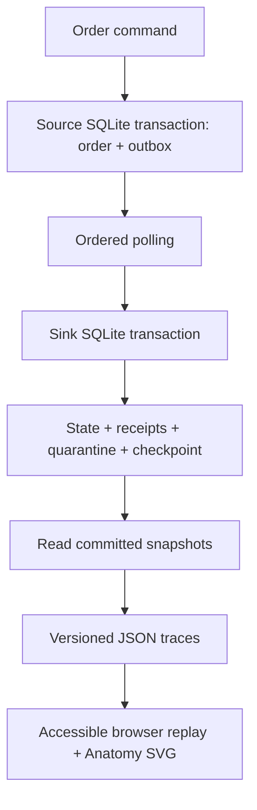

# SignalWorks: break the pipeline, keep the truth

A reliability lab built on [LedgerStream](ledgerstream.md), with an Anatomy SVG machine that explains what duplicate delivery, poison records, crashes and replay do to committed data.

**[Open the demo source](../demos/signalworks/index.html)** · [Recorded SQLite evidence](../evidence/signalworks-traces.json) · [Scenario implementation](../signalworks/scenarios.py)

The demo is a static website. To interact, serve the repository locally using the command below. GitHub's file viewer shows source; it does not run the website. No public hosting is claimed.

## Reproduce

Python 3.11+; standard library only for SignalWorks. From the repository root:

```sh
python3 scripts/verify_signalworks.py
python3 -m signalworks
node demos/signalworks/build.mjs
node --test demos/signalworks/player.test.mjs
python3 -m http.server 8000
```

Visit `http://localhost:8000/demos/signalworks/`. Node 20.10+ is needed only to rebuild the SVG page or run player tests; the generated demo is checked in. `python3 -m signalworks --output /tmp/traces.json` records an independent run without overwriting evidence.

## What this adds

LedgerStream already implemented source/outbox atomicity, replay identity, checkpoints, quarantine and tombstones. SignalWorks adds eight deterministic, inspectable scenario traces generated from real SQLite transactions, a browser replay, tests for trace contracts and playback cancellation, and an illustrated case study. It preserves the existing engine and project documentation.

## Architecture



Each experiment creates separate temporary source and sink databases. Event IDs are deterministic only inside a scoped scenario-generation patch; ordinary LedgerStream retains UUID generation. A trace records event identity, source sequence, entity version, disposition, committed checkpoint, active orders, receipt/quarantine/tombstone counts, paid cents and entity state. There are no wall-clock timings or invented throughput claims.

## Experiments and their guarantees

| Experiment | Observable result |
| --- | --- |
| Happy path | Two paid orders commit; synthetic total 7,500 cents |
| Duplicate | The same envelope is replayed; state and total remain unchanged |
| Quarantine | An invalid amount is quarantined at sequence 1; valid sequence 2 still commits |
| Crash/recovery | Failure after the first in-transaction write rolls back state, receipt and checkpoint; reopening the projection and polling from its checkpoint recovers both orders |
| Full replay | Two exact envelopes replay without changing committed state |
| Tombstone | A new stream sequence carrying old entity version 1 cannot undo deletion at entity version 2 |
| Sequence gap | Starting with sequence 2 is rejected and checkpoint remains zero |
| Conflicting replay | Reusing an existing sequence with changed contents is rejected without changing committed state |

Quarantine, conflicting replay and stale entity scenarios deliberately mutate transport envelopes and label those steps `transport_fixture: true`. They do not claim that source validation emitted invalid orders or that the source reused an old version. Source sequence and entity version are distinct ordering mechanisms.

## Why the machine looks this way

The infeed parcel represents an event waiting for consumption; inspection represents validation and identity/version checks. The receipt dock represents committed application, the return dock replay/stale rejection, and the separate tray quarantine. A crash keeps the parcel at inspection while the readouts retain the last committed snapshot. This is a metaphor, not an actual deployment topology.

The public page says **“Interactive replay of a recorded local run using synthetic data.”** Python is not executed in the browser. Every counter and narrative comes from one recorded snapshot; motion illustrates arrival at that state. Steps are boundary snapshots, not measurements inside an open transaction. The engine's tested rollback semantics establish what happened between them.

## Limits and tradeoffs

- SQLite makes failure boundaries reproducible without infrastructure. This is single-host; there is no claim of distributed exactly-once processing, Kafka deployment, or production operation.
- Receipts are retained indefinitely in this demo. Production needs retention, source ordering and replay policies.
- Quarantined records are consumed with a checkpoint; correction requires a new higher-sequence event.
- The public website replays checked-in runs. Arbitrary live input and a hosted backend are intentionally outside this project's scope.
- The figure uses rectilinear solids, no WebGL, pipes or round parts. It honors reduced motion and pauses playback offscreen. JavaScript is needed for replay; the initial illustration and case study remain available without it.

## Provenance

Developed with Codex assistance. Foundation: LedgerStream in this repository. Illustration generated using Ryan's [Anatomy](https://github.com/wheresryan22/anatomy) skill and MIT-licensed SVG kit; the vendored kit retains its license in `demos/signalworks/anatomy-kit/LICENSE`. The figure and scenario integration are new project code. Read, rerun, and understand the implementation before describing personal contributions in an interview.
